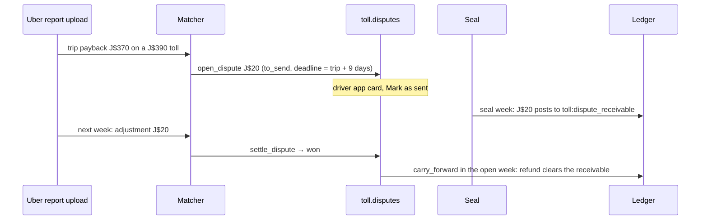
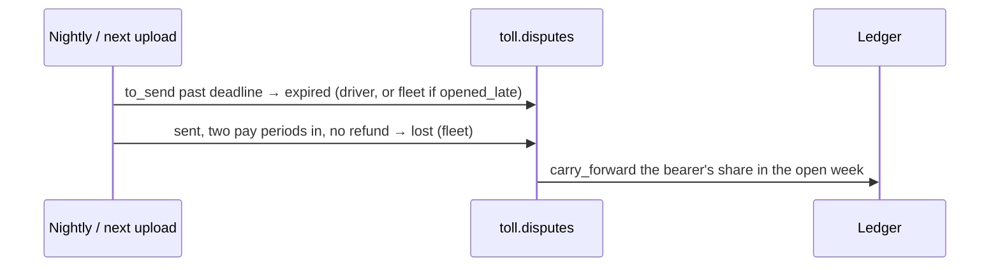

# Toll architecture — as-built audit and what it lacks

**Rev 6 · 2026-11-17 · For: the architecture reviewer · Status: OPEN, no build until the reviewer and the owner agree.**

**What it's for (one sentence):** every toll the fleet pays ends with the right person bearing it: the platform (paid back first time, or after a dispute), the driver or the fleet. Nothing is decided before the facts are in, and the week still closes on time.

The design doc is `docs/toll-architecture.md` (Rev 9, "Agreed", built Phase 0–3, live since the 14 Nov 2026 switch). This audit does not repeat it. Following the build playbook (`docs/how-we-build-playbook.md`):
- **Part A** is Step 2, "look before you plan": what is actually built and live, checked in code and in the live database on 17 Nov 2026.
- **Part B** lists the problems found, numbered, each with **one chosen fix**.
- **Part C** is the blueprint for those fixes (Data → Server → Screens with every button → Tests).
- **Part D** holds the done-tests, written before any build.
- **Part 0** (scope, scale, targets), **Part L2** (the platform envelope: what exists, gaps B12–B21, roles, state tables, flows, rollout) and **Part G** (owner questions) were added in Rev 5 after reviewer round 1.

The reviewer challenges any part. Claude replies and revises until no gap is left. The table at the end records each round.

---

## Part 0 — Scope, scale and non-functional targets (added Rev 5, reviewer round 1)

**Two layers** (reviewer round 1):
- **L1, the toll domain** (Parts A–D): who bears each toll, and do the numbers add up?
- **L2, the platform envelope** (Part L2, after Part D): can we run, prove, secure, change and recover it?

**Forward only (owner, 17 Nov 2026):** nothing in this document changes, re-runs or back-fills a week that is already reconciled, or any legacy data (the old toll records, the 219 old `fleet.claims`, money already decided). Every fix applies from the day it is switched on, to open weeks and new records only.

**The reviewer has no access to the app or the database.** Every "exists" claim in this document cites a file, a migration or a live query result (17 Nov 2026), so the reviewer can judge without seeing the system.

| Item | Today (fact) | Target |
|---|---|---|
| Companies on toll v2 | 1 (`tolls_v2` on for one company since 14 Nov 2026) | Multi-company by design; size: owner fact needed (Part G, Q1) |
| Drivers / vehicles | 1 driver, 1 car with a TransJam tag | Owner fact needed (Part G, Q1) |
| Weekly volume | ~15 tag tolls, ~70–80 Uber trips, ~14 trip paybacks, 0–1 adjustments, ~10 hand-logged InDrive trips | Design for 10× (≈150 tolls / 800 trips a week) with no architecture change; load-test once at that level |
| Timezone | Every week is Monday–Sunday, Jamaica (UTC−5, no daylight saving; ADR 0007). Platform times are stored as UTC instants and shown in Jamaica time. "`trust_utc`" (old `brain_policies`) means the Uber CSV times are taken as UTC, as written. | Unchanged |
| Currency | JMD only, all amounts in minor units (cents) as `bigint`; no FX | Unchanged; any other currency is refused at import until an FX policy exists |
| Rounding | Proportional splits round half-even per slice, and the last slice takes the remainder so the slices sum exactly (design C3, `docs/toll-architecture.md`) | Unchanged |
| Data residency | Supabase project `us-east-1` (US) | Owner fact needed: any Jamaican residency or insurer rule (Part G, Q2) |
| Environments | Production + each developer's private local copy (Docker, `supabase start`); **no standing staging** | Add staging (B16 fix) |
| Settlement cutoff | Weeks are closed by hand when the inputs are in; no fixed weekly deadline yet | Uber report uploaded within 2 days of week end (needed for the 9-day dispute window); toll seal available by the following Monday 09:00 |
| RPO / RTO | Not set; depends on the Supabase plan's backups (owner fact, Part G, Q8) | RPO ≤ 24 h (daily backup), RTO ≤ 4 h, plus a ledger reconstruction test (B16 fix) |
| Retention | Raw upload files are **not** kept: they go to the `ephemeral-evidence` bucket, which `evidence-cleanup` empties. Each import batch keeps `file_sha256`, file name, `rows_parsed / committed / duplicate / rejected`, coverage dates | Raw files kept 7 years, immutable (B16 fix) |

## Part A — What the toll architecture is today (as built)

### A1. Purpose (from the design, unchanged)

Every toll the fleet paid gets one answer to "who bears this cost?" (platform, driver or fleet), and the week adds up: spend = platform + driver + fleet, nothing undecided. The tag account adds up separately (opening + top-ups − usage = closing).

### A2. Records (live row counts, 17 Nov)

| Table | Rows | What is in it live |
|---|---|---|
| `toll.charges` | 71 | **All** `tag_statement` / `tag`. **0** driver cash, **0** Roam, **0** manual |
| `toll.paybacks` | 70 | Uber only: `trip_line` (received by fleet or driver) and 1 `adjustment` (J$70, 11 Oct; the owner kept it "with no toll" on 15 Nov) |
| `toll.platform_trips` | 512 | **Uber only** (card and cash). No InDrive, no Roam |
| `toll.allocations` | 83 | Platform and driver slices |
| `toll.payback_unlinked_decisions` | 3 | "Keep with no toll" |
| `toll.decisions` | 114 | Intents used: `import_batch`, `apply_suggestion`, `driver_pays`, `leave_payback_unlinked`, `seal_week` |
| `toll.suggestions` | append-only | Matcher output; withdrawn rows supersede |
| `toll.carried_facts`, `duplicate_reviews`, `reported_take_backs`, `alerts` | 0 each | Never exercised live |
| `toll.platform_settings` | **0** | No platform row, so `pays_tolls_back` / `auto_apply` / `payback_mode` use code defaults |
| `toll.plaza_rules` | **0** | No duplicate windows or plaza rates |
| `toll.tag_topups` | 4 | |

### A3. Inputs (adapters) and how each reaches the toll system

| Source | Path | Live |
|---|---|---|
| Tag usage statement | Step 1 upload → `toll/v2/import` (`tag_statement`) | Yes |
| Tag top-ups | Step 1 upload → `tag_topups` | Yes |
| Uber weekly CSV | Step 1 upload → `platform_trips` + `paybacks` (`trip_line` per trip toll refund; support adjustments → `adjustment`) | Yes |
| Driver cash toll | Roam driver app → `POST toll/v2/driver-cash` → `charges` (`driver_cash`, unverified until a receipt check) | Path exists; **0 rows** live |
| Roam rides | Rides hooks `native_ride_charge` / `native_cash_settled` write charge + native payback + allocation | Built; **0 rows** live |
| InDrive | Adapter reads an **InDrive export file** only (`packages/toll-core/src/v2/adapters/indrive.ts`) | **Never used.** The owner logs InDrive trips by hand (`fleet.trips`, `isManual`, request and drop-off times, cash), and those never reach `toll.platform_trips` |

### A4. The matcher

- Code: `packages/toll-core/src/v2/matcher/engine.ts`, config `MATCHER_CONFIG_V1` (hard-coded): approach 45 min, post-trip 15 min, amount "close" = 5%, auto-apply at score ≥ 90 and only when the platform setting allows it (no setting row, so off).
- A trip payback pairs with a charge by **time window on the trip** (vehicle/driver). Amount only changes the score.
- An `adjustment` payback (no trip) pairs by **driver + date, at most 7 days back** (`adjustment_lookback_days: 7`).
- Excluded: charges already fully decided, sealed weeks, legacy rows, duplicates.
- Runs after every import and on a sweep (`toll-matcher-sweep` cron). A pair that is no longer a candidate gets a `withdrawn` suggestion.
- **A second, older config also exists:** `toll.brain_policies` (default row: approach 45, post-trip 15, variance 5%, `trip_time_mode trust_utc`…), used by the `toll-brain` edge function (v181, geofence and classify). The v2 matcher does not read it. Two sources of truth for the same knobs.

### A5. Commands (17 intents in `toll_v2_command`)

`import_batch`, `apply_suggestion`, `link_payback`, `driver_pays`, `fleet_absorbs`, `leave_payback_unlinked`, `undo_decision`, `confirm_duplicate`, `release_duplicate`, `verify_cash_receipt`, `reject_cash_receipt`, `correct_charge_amount`, `correct_charge_week`, `reverse_payback`, `carry_forward`, `seal_week`, `reopen_week`. Each carries `command_id` + record versions; every command is an append-only decision.

### A6. States (derived, never stored)

- **Charge:** `duplicate`, `rejected`, `unverified` (blocks seal), `awaiting_cash` (Roam cash, doesn't block), `decided` (allocations = amount), `pending` (anything else).
- **Payback:** `pending`, `part_allocated`, `allocated`, `left_unlinked`, `reversed`.
- There is **no state for "the platform under-paid this toll"**, and none for "a dispute is open".

### A7. Seal

`seal_week` refuses until every charge is decided, with no unverified cash, no open duplicate pair and nothing unallocated (G1 in the design). Late facts after a sealed and paid week go through `carry_forward` into the open week (P18–P20).

### A8. Money

Double-entry postings P1–P20 to `org:<co>:toll:*` accounts (`payback_unallocated`, `receivable_platform`, `receivable_driver`, `recovered_in_driver_cash`, `platform_payout_clearing`…). The sealed result is `ledger.week_statements` `kind = 'toll_week'`. Driver settlement reads the sealed toll statement (`resolveTollInputs`).

### A9. Week Reconciliation use

- Step 1: tag usage, top-ups, cash tolls (driver-reported since WRA-72).
- Step 3 Tolls: groups *Suggested matches*, *Pick the right trip*, *Tolls with no trip*, *Decided*; Seal tolls.
- Step 4 Tag account: reads `toll_sys_tag_account_weeks`.
- Steps 7–8: settlement and close read the sealed toll statement.

---

## Part B — Problems found (what it lacks), each with one chosen fix

Each gap: what the business needs, what the **old system** did (retired 14 Nov), what v2 does, and the evidence.

### B1. Dispute life-cycle for under-paid tolls (missing)

- **Need:** when a platform pays back less than the toll, or nothing on a trip it should cover, the driver disputes it with the platform and the fleet tracks it to a result.
- **Old:** a `Toll_Refund` claim per shortfall, `Open → Sent_to_Driver → Submitted_to_Uber → Resolved | Rejected`, with the dispute message written for the driver. Resolution reasons: `Reimbursed`, `Charge Driver`, `Write Off`, `Business Expense` (`apps/fleet/src/types/data.ts` `Claim`). Live: 219 claims, all resolved, the last on 26 Oct.
- **v2:** no dispute record, state, message or list. The shortfall is just a remainder on the charge.
- **Evidence:** week of 9 Nov: 12 tolls part-paid (Uber J$370 on J$390, J$275 on J$280), J$240 total, with no dispute anywhere.
- **Fix (one):** a dispute record per amount a platform should have paid and didn’t (`toll.disputes`, C1). The system opens it automatically, it carries its own states, and it always ends in exactly one result.

### B2. The seal forces an early decision on a shortfall (design conflict)

- **Need:** the week should close and drivers get paid while a dispute is still open.
- **v2:** `seal_week` requires every charge decided, so the person must press Driver pays or Fleet pays on the shortfall before the dispute could ever come back.
- **Effect:** the dispute's outcome can't be honoured without a manual undo/carry-forward.
- **Fix (one):** an open dispute counts as decided for the seal. At seal, its amount posts to a new account `toll:dispute_receivable` (owed by the platform, pending). The dispute’s result posts later in the open week, using the existing `carry_forward` rule (C1, C2).

### B3. Dispute refunds don't reliably find their toll (partial)

- **Old:** a dispute refund matched its claim and closed it; if the driver had been charged, the charge was reversed (`disputeRefundTripSyncEnabled`, 5 Jul 2026).
- **v2:** an Uber support adjustment becomes an `adjustment` payback, matched by driver + date **within 7 days only**. Disputes often take longer. Once the shortfall was decided, the charge is excluded (`fully_decided`), so the refund can't attach. It becomes unallocated money for a person, and a driver charge is never reversed automatically.
- **Evidence:** the one live adjustment (J$70, 11 Oct) found no toll and was kept "with no toll" by hand on 15 Nov. There was no dispute for it to settle.
- **Fix (one):** an `adjustment` payback first looks for an open or expired dispute (same driver and platform, amount ≤ owed, in the platform report for the pay period after the dispute was sent, or the one after that (owner, 17 Nov 2026: a refund always comes in one of those two pay periods, never later); no 7-day limit). If it finds one, it settles that dispute. Only if none fits does today’s 7-day charge match run. A refund on a toll already charged to the driver reverses that charge in the open week (C2).

### B4. Lost or forgotten disputes have no rule (missing)

- **Need:** a dispute the platform rejects, or one the driver never sends, must end with a clear bearer.
- **v2:** no deadline, reminder, expiry or policy. The bearer is whatever a person picks on step 3, with no rule behind it.
- **Fix (one):** the dispute window is the **platform's** rule, so it lives on the platform setting: **Uber = 9 days from the trip** (owner, 17 Nov 2026). Fleet Policy holds, per company: a **lost** dispute is borne by the **fleet** (as old `Business Expense`); an **expired** dispute the driver had time to send is borne by the **driver** (as old `Charge Driver`). A dispute that **opened too late to send** (the platform's data arrived after the window, or with under 2 days left) is borne by the **fleet**, because the driver never had a fair chance. The owner can change the bearers. A nightly job expires overdue disputes and posts the bearer (C1, C2).
- **What 9 days means for the architecture:** a dispute can only be sent while the window is open, so it must open the moment the platform's data arrives, not when the week is reconciled. The Uber weekly report must be uploaded within days of the week ending. Weeks reconciled weeks later (as with October, done in mid-November) can't be disputed and go straight to the late-open rule above.

### B5. The driver is never asked to dispute (missing)

- **Old:** `Sent_to_Driver` with a generated message.
- **v2:** nothing in the Roam driver app or the fleet screens.
- **Fix (one):** the Roam driver app shows every `to_send` dispute as a card with the trip, toll, amount owed and the dispute text ready to copy, plus a **Mark as sent** button. The driver’s Mark as sent (time-stamped) is the evidence; no screenshot is required (C3).

### B6. Hand-logged InDrive trips are invisible to tolls (missing for how the business works)

- **v2:** only an InDrive **file** reaches `platform_trips`. The owner logs InDrive by hand, so a toll during an InDrive trip is shown as "Tolls with no trip".
- **Open business fact:** how InDrive tolls are paid. The trips are cash. Does the rider pay the toll to the driver in the fare (old system: **cash wash**), or does nobody pay it back?
- **Evidence:** `platform_trips` has `uber` only; 9 Nov has 8 hand-logged InDrive trips on Sun 15 (none had a tag toll that day, so no wrong row yet).
- **Fix (one):** every hand-logged trip (any platform, `fleet.trips` with request and drop-off times) is written to `toll.platform_trips` when it is saved and again on the nightly run (a new adapter, "logged trips").

### B7. Cash-trip tolls (cash wash) aren't modelled for non-Uber platforms

- **Old:** `tollRefundResolution = cash_wash`: the rider paid the toll to the driver in cash, so nobody is charged.
- **v2:** Uber cash trips are covered (a `trip_line` payback with `received_by = driver`, posted to `recovered_in_driver_cash`). Other platforms' cash trips have no path (follows from B6).
- **Fix (one):** a new platform payback mode, `cash_in_fare`. For InDrive (and any platform set to it), a toll during a **cash** trip is covered by the rider’s fare: the system writes a native-style payback `received_by driver` and allocates it (cash wash). Nobody is charged and no dispute opens. A card trip on a platform that never pays tolls back goes to the policy bearer.

### B8. "Paid back less than the toll" has no state and is shown as "no trip"

- **v2:** a part-allocated charge with no live suggestion falls into *Tolls with no trip* ("No Uber trip at this time"), showing the full toll, not the remainder (WRA-73 in `docs/week-reconciliation-architecture-audit.md`). The screen decides the grouping; the server has no such state (A6).
- **Fix (one):** two new charge states, derived on the server: `short_paid` (a platform paid part, the rest not yet in a dispute) and `disputed` (an open dispute covers the rest). Every screen and report reads the state; no screen does its own grouping (WRA-73 builds the display).

### B9. A systematic platform rate difference isn't understood

- **Fact:** Uber refunds its own toll rate. Since the toll price rose, every Portmore crossing is J$20 short and every Spanish Town crossing J$5 short.
- **v2:** the 5% "amount close" rule just misses (J$20 on J$390), so these never auto-apply. `plaza_rules` is empty: there is no record of each plaza's tag price versus each platform's refund rate, so a known, repeating difference looks like 12 separate problems every week.
- **Fix (one):** `toll.plaza_rules` gains each plaza’s tag price by date and each platform’s refund rate by date. The matcher compares a payback with the **platform’s rate**, so Uber J$370 at Portmore is an exact match. The known gap (J$20) still opens a dispute, and the screen explains it: "Uber pays J$370, tag J$390".

### B10. Configuration has no owner

- `toll.platform_settings` has **no rows**: `pays_tolls_back`, `payback_mode` and `auto_apply` are code defaults nobody set.
- The matcher's knobs live in code (`MATCHER_CONFIG_V1`) **and** in `toll.brain_policies` (A4).
- **Fix (one):** one home for every matching and payback setting: `toll.platform_settings` (one row per platform per company, created at switch-on, defaults written, not implied) + `toll.plaza_rules`. The v2 matcher reads only these, and `toll.brain_policies` is not used by v2. Only a fleet owner or manager may change them, and every change is a decision row.

### B11. Built paths never exercised live

Driver cash charges, Roam native charges, `carry_forward`, duplicate review, take-backs (`reverse_payback`) and `fleet_absorbs` have **0 live rows**. Their tests pass locally, but none has met real data.

---
- **Fix (one):** before any of the new parts goes live, each never-exercised path (driver cash, Roam native, `carry_forward`, duplicates, take-backs, `fleet_absorbs`) gets a done-test run on a private copy with real-shaped data. A nightly check alerts the first time each path posts live, so its first real use is looked at.

## Part C — Blueprint for the fixes (Data → Server → Screens → Tests)

### C1. Data

| Record | One row per | Fields and rules |
|---|---|---|
| **`toll.disputes`** (new) | One amount a platform should have paid on one charge and didn't | `organization_id`, `charge_id`, `platform`, `platform_trip_id`, `driver_id`, `owed_minor` > 0, `state` (`to_send` \| `sent` \| `won` \| `part_won` \| `lost` \| `expired`), `opened_at`, `sent_at`, `deadline` (trip date + the platform's `dispute_window_days`), `opened_late` (true when opened with under 2 days left or after the deadline), `recovered_minor`, `bearer` (set on `lost` / `expired` / the rest of `part_won`), `decision_ids`, `version`. **Rules:** at most one open dispute per charge; `recovered_minor` ≤ `owed_minor`; a final state (`won`, `part_won`, `lost`, `expired`) never changes except by `undo_decision`. |
| `toll.dispute_links` (new) | One payback slice that settled a dispute | `dispute_id`, `payback_id`, `amount_minor`, `decision_id`, `reversed_by` |
| Account `org:<co>:toll:dispute_receivable` (new) | — | Asset: amounts the platform owes while a dispute is open. Balance = Σ open dispute `owed_minor` − recovered. **Check:** it equals the sum of open disputes at every nightly run. |
| `toll.platform_settings` (filled) | One per platform per company | Adds the `payback_mode` value `cash_in_fare`. Written at switch-on with explicit defaults (Uber: `trip_line` + adjustments, opens disputes; InDrive: `cash_in_fare`; Roam: `native`). |
| `toll.plaza_rules` (extended) | One per plaza | Adds `tag_price_minor` and `platform_rates` (by platform, each with `valid_from`). |
| `toll.platform_settings` (dispute fields) | One per platform per company | `takes_disputes` (Uber: yes), `dispute_window_days` (**Uber: 9**). |
| Fleet Policy (extended) | One per company | `toll_dispute_lost_bearer` (default `fleet`), `toll_dispute_expired_bearer` (default `driver`); a dispute with `opened_late` is always borne by the fleet. |
| Charge states (derived) | — | Adds `short_paid` and `disputed` to the list in A6. |
| `toll.platform_trips` | — | New source: the "logged trips" adapter from `fleet.trips` (B6). |

### C2. Server (commands and jobs; each carries `command_id` + versions and writes a decision)

| Command / job | Who | What it does |
|---|---|---|
| `open_dispute` | System (the matcher, when a trip payback leaves a remainder) or a person | Creates a `to_send` dispute for the remainder. Charge state → `disputed`. |
| `mark_dispute_sent` | Driver (driver app) or a person | `to_send` → `sent`; stamps `sent_at`. |
| `settle_dispute` | System (the matcher, when an `adjustment` payback fits) or a person (link) | Writes a `dispute_link` and raises `recovered_minor`. Full → `won`. Part, then the person closes it → `part_won` (the rest to the lost bearer). If the driver was charged for that amount, the charge is reversed in the open week. |
| `close_dispute_lost` | System, or a person | **Automatic:** once the platform reports for both pay periods after `sent_at` are in and neither held the refund, the dispute → `lost` and the rest goes to the policy lost bearer. A person can also close it as lost earlier (for example, the platform replied no). |
| Nightly `expire_disputes` | System | `to_send` past `deadline` → `expired`; the rest goes to the policy expired bearer. |
| `seal_week` (changed) | A person | An open dispute counts as decided: its open amount posts to `toll:dispute_receivable`. It still refuses a `short_paid` charge, which only happens on a platform that doesn't take disputes, because the system opens the dispute first. |
| Dispute result after the seal | System | Posted in the open week through `carry_forward` (new `kind` `dispute_result`); the sealed week is never touched. |
| Matcher (changed) | System | Adjustments: open or expired disputes first (B3). Trip paybacks: compared with the platform's plaza rate (B9). Cash trips on `cash_in_fare` platforms: cash wash (B7). |
| Logged-trips adapter | System, on trip save and nightly | Upserts hand-logged `fleet.trips` into `toll.platform_trips` (B6). |

### C3. Screens — every screen and every button

**Week Reconciliation, step 3 Tolls** (groups come only from the server state):

| Group | Shows | Buttons |
|---|---|---|
| Suggested matches | Toll, trip, payback, score | **Confirm** (one), **Confirm all** |
| Pick the right trip | Toll and the 2 or more trips | **This trip** on each |
| **Disputes** (new) | "Portmore J$390 · Uber paid J$370 · J$20 disputed · Uber trip 6:27–8:25 AM", state, days left | **Mark as sent** (to_send), **Refund received** → pick the payback (sent), **Lost** (sent), **Open trip** |
| Tolls with no trip | Toll only | **Driver pays**, **Fleet pays** |
| Decided | Toll and how it was decided | **Undo** |
| Seal tolls | Spend = platform + driver + fleet **+ disputed** | **Seal tolls** |

**Driver Settlements** — a **Disputes** tab per driver: open disputes, days left, overdue in red. Buttons: **Mark as sent**, **Lost**, **Open week**.

**Roam driver app** — a "Dispute this toll with Uber" card per `to_send` dispute: trip date and time, toll, amount owed, the dispute text. Buttons: **Copy text**, **Mark as sent**.

**Fleet Admin → Fleet Policy → Tolls** — fields: who pays a lost dispute, who pays an expired dispute; per platform: payback mode, pays tolls back (yes / no), takes disputes (yes / no), dispute window in days (Uber 9); per plaza: tag price and each platform's rate with a date. Buttons: **Save**, **Add rate**.

**Roam driver app card** shows the days left of the platform's window ("6 of 9 days left"); it turns red with 2 days left.

### C4. Tests — rules that must always hold (each one a test)

1. Every dispute ends in exactly one final state, and its amounts add up: recovered + borne = owed.
2. A won dispute never leaves the driver charged for that amount.
3. The seal never waits on an open dispute, and never seals a `short_paid` charge.
4. With disputes open, the week still adds up to the cent: spend = platform + driver + fleet + `dispute_receivable`.
5. `toll:dispute_receivable` = Σ open disputes, every night.
6. A refund is matched to a dispute only in the two pay periods after it was sent; once both are in with no refund, the dispute is lost by itself.
7. A cash trip on a `cash_in_fare` platform never opens a dispute or charges anyone.
8. A sealed week never changes; dispute results land in the open week.

---

## Part D — Done-tests (plain words, written before any build)

1. A J$390 toll on an Uber trip, Uber pays J$370 → a J$20 dispute opens by itself, and the driver sees it in the app.
2. The week seals with that dispute open; Driver Settlements pays the driver; J$20 sits in "owed by Uber".
3. The driver taps **Mark as sent**; Uber's J$20 adjustment arrives in the next week's report → the dispute is won and the J$20 clears.
3b. The adjustment arrives one week later instead (the second pay period after sending) → still matched and won.
4. The same, but the fleet had charged the driver the J$20 → the charge is reversed in the open week.
5. The driver never sends it; 9 days from the trip pass → the dispute expires, and the driver bears J$20 in the open week.
5b. The Uber report is uploaded 10 days after the trip → the dispute opens already late (`opened_late`) → the fleet bears J$20, never the driver.
6. No refund in either of the two pay periods after sending → when the second report is uploaded, the dispute is lost by itself and the fleet bears J$20. (A person can also press **Lost** earlier.)
7. Uber pays J$10 of J$20 → the person closes it → J$10 recovered, J$10 to the lost bearer.
8. A hand-logged cash InDrive trip covers a toll → cash wash; nothing in "no trip", no dispute.
9. A toll during a Roam ride → native, unchanged.
10. A toll with no trip on any platform → only in "Tolls with no trip".
11. Replay of the week of 9 Nov 2026 → 12 disputes (J$240) in **Disputes**, and the Portmore paybacks are exact matches at Uber's rate.

---

## Part L2 — The platform envelope (added Rev 5, reviewer round 1)

### L2.1 What already exists (facts for the reviewer, checked 17 Nov 2026)

| Reviewer asked for | Status | Evidence |
|---|---|---|
| Migrations in version control, forward-only, tested on a fresh copy | **Exists** | `supabase/migrations/` (timestamped); `scripts/validate-migration-sql.mjs` refuses future dates; CI `verify-migrations-replay.yml` replays every migration on an empty database; `scripts/assert-migration-versions-parity.mjs` compares the repo with production's version list |
| DB-enforced amount rules | **Exists** | Check constraints (`amount_minor > 0`, allowed `source`, `kind`, `paid_by`, `evidence_status`, `time_precision`); triggers `charges_amount_caps`, `paybacks_amount_caps`, `allocations_caps`, `payback_unlinked_caps` (allocations can't exceed the amount) |
| Idempotent imports | **Exists** | Unique `(organization_id, source, source_ref)` on charges, `(organization_id, platform, reference)` on paybacks, `(organization_id, platform, platform_trip_id)` on trips; `(organization_id, command_id)` on decisions |
| Append-only audit backbone | **Exists** | Triggers `decisions_append_only`, `suggestions_append_only`, `audit_log_append_only`, `nightly_results_append_only` |
| File provenance on the batch | **Exists** | `fleet.import_batches`: `file_sha256`, `file_name`, `semantic_key`, `supersedes`, `rows_parsed/committed/duplicate/rejected/spilled`, `coverage_start/end`, `week_keys` |
| Company isolation | **Exists, two levels** | RLS on every `toll` table (25 of 25); the Fleet server uses the service key (which skips RLS), so every write goes through `toll_system.*` functions that take the company from the user's token (design B7) |
| Single-writer matcher | **Exists** | `toll_system.match_claim` claims queue rows with `FOR UPDATE SKIP LOCKED` and a 10-minute lease; a retried run gets `claim_gone` and does nothing |
| Recompute after money changes (outbox) | **Exists** | Triggers `toll_*_period_refresh` queue a period refresh; Week Recon queues driver-week rebuilds (WRA-67) and desk rebuilds (WRA-43) |
| Nightly proof the books add up | **Exists** | `toll.nightly_results` (60 rows, last 04:25 UTC 17 Nov, all `ok`): each `toll:*` account's ledger balance equals its records |
| Alerts | **Exists, barely used** | `toll.alerts` (one open per company + problem), 0 rows; metric list in `docs/toll-architecture.md` "Metric and alert definitions" (views, not dashboards) |
| Feature switch per company | **Exists** | `toll.switch_state.tolls_v2` |
| Deploy through CI only | **Exists** | `deploy-supabase-edge.yml`, `deploy-recon-worker.yml`, `vercel-path-deploy.yml`; pre-push checks (`scripts/check-before-push.mjs`) |
| Roles | **Exists, coarse** | Permissions in code (`packages/auth-client/src/permissions.ts`): `toll.manage` = owner or an active fleet_owner / fleet_manager seat; `toll.view` adds fleet_accountant; the database mirrors it, and a drift test guards it. Driver cash: the driver's own user only (`toll/v2/driver-cash` uses the caller's driver context) |
| Correlation IDs and structured logs | **Partly** | Week Recon: `x-recon-correlation-id`, JSON `reconPhase` logs; toll commands carry `command_id`; no trace across import → matcher → ledger |
| Week-close approval (four eyes) | **Partly** | Week Recon Close: prepare + approve, or self-approve with a written reason (WRA-32). Toll commands have none |

### L2.2 Gaps found, each with one chosen fix

| # | Gap | Fix (one) | Priority |
|---|---|---|---|
| **B12** | **Config has two owners** (`MATCHER_CONFIG_V1` in code and `toll.brain_policies`); `platform_settings` has 0 rows (silent defaults); `plaza_rules` has 0 rows | Seed `platform_settings` + `plaza_rules` at switch-on, refuse to match when a company's row is missing (loud, not silent). The v2 matcher reads only these. `brain_policies` stays owned by `toll-brain` (v181) **for Roam ride geofence detection and quotes only**, and an ADR records that boundary. Every settings change is a decision row (actor, before, after, reason) | P0 |
| **B13** | **Sealed-week protection is in the commands only**, not in the database | A trigger on `allocations`, `charges`, `paybacks`, `payback_unlinked_decisions`, `carried_facts` and `disputes` refuses any insert, update or delete that touches a sealed week (except the seal and reopen functions themselves, by a session flag). Ledger rows already can't change (posting RPC) | P0 |
| **B14** | **No four-eyes check on risky money commands** | `undo_decision`, `correct_charge_amount`, `correct_charge_week`, `reopen_week`, `close_dispute_lost` and policy changes need a second person above J$5,000 (any amount for `reopen_week`), using the existing Week Recon approval pattern (prepare + approve, or self-approve with a written reason when the company has one manager). Both actors are stored on the decision | P0 |
| **B15** | **Role matrix not written down** ("a person" in this doc) | Matrix (below, L2.3) mapped to the existing permissions; the driver can only act on their own disputes and cash tolls | P0 |
| **B16** | **Raw files not kept; no staging; RPO/RTO not set; no rebuild test** | Store every uploaded file in a private, versioned bucket (`toll-evidence`, never cleaned) keyed by `file_sha256`, kept 7 years. A standing **staging** project with masked, real-shaped data, where every release runs the done-tests and the never-used paths (B11). A **ledger reconstruction test**: rebuild every `toll:*` balance from decisions + records **since the 14 Nov 2026 switch** and prove it equals the ledger (extends the nightly check). Restore drill each quarter | P0 (files, rebuild test) / P1 (staging, drill) |
| **B17** | **Kept-with-no-toll money has no end** | `payback_unallocated` holds J$1,200 decided "keep with no toll" (J$70 + J$780 on 15 Nov, J$350 on 17 Nov). Fix: from switch-on, a left-unlinked payback posts on to `toll:other_income` (the fleet's toll income) at the decision, so `payback_unallocated` only holds undecided money from then on; a daily "unallocated paybacks" list with age. The J$1,200 already kept stays as it is (forward only) | P0 |
| **B18** | **Adapters don't detect a changed file layout** | Each adapter validates required columns and their types before writing anything. An unknown or missing column fails the batch with a named error (no partial write: an import batch is all-or-nothing, which `import_batch` already does per batch). The failed file is kept (B16) and can be re-run after a fix; a contract test per adapter uses a real, masked sample file | P1 |
| **B19** | **No dashboards, SLOs or runbooks for tolls** | Dashboards: dispute funnel, unallocated paybacks, receivable vs open disputes, import row counts, matcher lag, nightly results. SLOs: matcher done ≤ 2 min after an import; nightly check 0 differences; 0 sealed-week changes; Uber report in ≤ 2 days after week end (alert on day 3). Runbooks: import failed, matcher stalled, nightly check failed, seal blocked, dispute job missed, Uber report late | P1 |
| **B20** | **No property tests for money rules** | Property tests (random charges / paybacks / allocations / disputes): sums conserved, no negative owed, exactly one final dispute state, week adds up; plus chaos cases: kill the matcher mid-run, a corrupt CSV row, replay a batch | P1 |
| ~~B21~~ | ~~Old claims not mapped~~ | **Dropped (owner: leave legacy data alone).** The 219 `fleet.claims` stay as they are | — |

**Explicitly not doing** (reviewer agrees): no sharding, no Kafka or event bus, no generic rules engine, no partitioning at this size.

### L2.3 Role matrix

| Action | Driver | Fleet accountant | Fleet manager / owner | System |
|---|---|---|---|---|
| See own tolls, disputes, cash tolls | ✓ (own only) | ✓ | ✓ | — |
| Log a cash toll | ✓ (own only) | — | ✓ | — |
| Mark a dispute sent | ✓ (own only) | — | ✓ | — |
| Upload files, confirm matches, Driver pays / Fleet pays | — | — | ✓ | — |
| Close a dispute lost, undo, correct amount or week, reopen a week, change toll settings | — | — | ✓ + second person (B14) | — |
| Open / settle / expire disputes, match, nightly checks | — | — | — | ✓ |
| View everything | — | ✓ | ✓ | — |

### L2.4 State tables (for the C4 tests to run as a matrix)

**Dispute** (state × event → state):

| From | `mark_dispute_sent` | refund fits (`settle_dispute`) | person closes part | `close_dispute_lost` / 2 periods pass with no refund | deadline passes |
|---|---|---|---|---|---|
| `to_send` | `sent` | `won` / stays (part) | — | — | `expired` |
| `sent` | — | `won` / stays (part) | `part_won` | `lost` | — |
| `won`, `part_won`, `lost`, `expired` | final (only `undo_decision`) | final | final | final | final |

**Charge** (derived): `pending` → `short_paid` (a payback covers part) → `disputed` (dispute opened) → `decided` (dispute final, or Driver / Fleet pays). Plus the existing `duplicate`, `rejected`, `unverified`, `awaiting_cash`.

### L2.5 Key flows (sequence)

### L2.6 Rollout

1. Build behind a per-company switch (`toll_disputes`, `cash_in_fare`, `logged_trips`), all off.
2. Prove on staging with the done-tests + property tests + the 9 Nov replay.
3. Switch on for the owner's company; one real week with screenshots; the nightly check and receivable check must stay at 0 differences for 14 nights.
4. Roll back by switching off: no new disputes open; open ones keep their state and can be closed by hand.

## Part G — Questions only the owner can answer (reviewer round 1)

| # | Question | Answer |
|---|---|---|
| Q1 | Scale in 1 and 3 years: companies, drivers, cars, weekly tolls and trips | _owner_ |
| Q2 | Any audit, tax, insurer or data-residency rule on toll records (how long to keep them, where they must live)? | _owner_ |
| Q3 | Team: who runs this day to day and who is on call when something breaks? | Today: the owner runs the weekly close; Claude (planner) and Cursor (builder) build; no separate ops engineer. _owner to confirm_ |
| Q4 | Is company isolation a hard security boundary? | **Answered from the code:** yes. RLS is on every toll table, and server writes go through functions that take the company from the user's token (L2.1) |
| Q5 | InDrive: does the rider pay the toll to the driver inside the cash fare? (decides `cash_in_fare`, B7) | _owner_ |
| Q6 | Who writes and approves the dispute text the driver sends to Uber? | _owner_ |
| Q7 | Does finance still need the 219 old claims, and for how long? | **Answered:** leave legacy data alone; they stay in `fleet.claims` untouched |
| Q8 | Which Supabase plan / backup level is the production project on (sets RPO / RTO)? | _owner_ |

## Part E — Until this is agreed

On step 3 the owner decides each shortfall as the old claims did (Fleet pays = Business Expense, Driver pays = Charge Driver). A later refund needs a manual decision. WRA-73 (show "paid back less than the toll" correctly) can go ahead, because it changes no money.

---

## Rounds

| Round | Date | Who | Outcome |
|---|---|---|---|
| 1 | 2026-11-17 | Claude | Rev 1: as-built audit (Part A), gaps B1–B11, questions and a proposed direction |
| 2 | 2026-11-17 | Claude | Rev 2 (owner: follow the playbook): one-sentence goal; one chosen fix per problem (B1–B11); blueprint C1 Data, C2 Server, C3 Screens with every button, C4 rules; Part D done-tests; no open options |
| 3 | 2026-11-17 | Claude | Rev 3 (owner fact: Uber gives drivers 9 days to dispute): window moved to the platform setting (Uber 9); disputes open the moment platform data arrives; `opened_late` → fleet bears; done-test 5 + 5b |
| 4 | 2026-11-17 | Claude | Rev 4 (owner fact: a dispute refund always arrives in the next pay period or the one after, never later): refund matching limited to those two periods; a dispute with no refund after both is lost automatically; done-tests 3, 3b, 6 |
| 5 | 2026-11-17 | Reviewer | Round 1: L1 domain strong; L2 envelope (NFRs, security, observability, resilience, release, governance) almost absent; asked for Part 0, L2 gaps, roles, state tables, diagrams, rollout, 7 questions |
| 6 | 2026-11-17 | Claude | Rev 5: checked every L2 point against the code and live data (L2.1, with evidence; much already exists). Added Part 0, gaps B12–B21 each with one fix and a priority, role matrix, dispute/charge state tables, sequence diagrams, rollout, Part G owner questions. Corrected: the J$70 adjustment was kept "with no toll" by the owner (not ownerless); found J| 4 | 2026-11-17 | Claude | Rev 4 (owner fact: a dispute refund always arrives in the next pay period or the one after, never later): refund matching limited to those two periods; a dispute with no refund after both is lost automatically; done-tests 3, 3b, 6 |
| 7 | 2026-11-17 | Claude | Rev 6 (owner: don't touch reconciled weeks or legacy data): forward-only rule in Part 0; B21 dropped; B17 and the reconstruction test from switch-on only; Q7 answered |
,200 kept-with-no-toll money with no end account (B17) |
